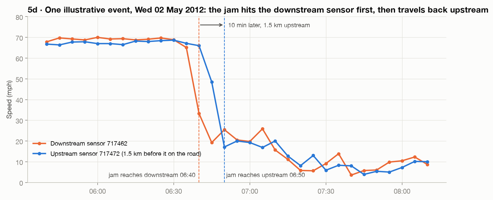

# Traffic Flow Prediction & Signal Control via Graph Attention Networks

**Does a model that sees the road network forecast traffic better than strong per-sensor models? And where does the gain come from?**
Speed forecasting 5–60 min ahead on METR-LA (207 Los Angeles freeway sensors), comparing per-segment XGBoost / Random Forest baselines with graph neural networks (STGAT, DCRNN) under a leak-free protocol, plus an optional **simulated** signal-control experiment in SUMO.

> Signal control in this project is **simulation only**. Nothing here controls real traffic.



*Phase 1 finding: congestion propagates **backwards** along LA freeways at ≈16 km/h. On strongly coupled links the downstream sensor slows first 4× more often than the upstream one. A per-sensor model can't see this coming; a graph model can.*

## Status

| Phase | | Status |
|---|---|---|
| 0 | Setup, repo, pre-reads | ✅ |
| 1 | Data + EDA ([report](docs/phase_reports/PHASE_1_REPORT.md)) | ✅ |
| 2 | Leak-free preprocessing | ⏭ next |
| 3 | ML baselines (XGBoost per segment, multi-output RF, LSTM) | ☐ |
| 4 | Identify the gap | ☐ |
| 5 | Graph models (STGAT, DCRNN) + ablations | ☐ |
| 6 | Fair comparison, horizon & peak metrics, significance | ☐ |
| 7 | Congestion maps | ☐ |
| 8 | Simulated signal control (SUMO, optional) | ☐ |
| 9 | Extensions & packaging | ☐ |

The full plan, with every requirement of the brief mapped to a phase, is in **[docs/PROJECT_GUIDE.md](docs/PROJECT_GUIDE.md)**.

## Results
*Filled in Phase 6.* MAE / RMSE / MAPE at 15 / 30 / 60 min, peak vs off-peak, for every model.

## Reproduce
```bash
make setup      # Python 3.11 venv (uv) + pinned requirements; macOS also: brew install libomp
make data       # DCRNN repo graph files + metr-la.h5 from its Google Drive link
make eda        # re-executes notebooks/01_eda.ipynb → reports/figures/, results/phase1_findings.json
make test lint
```

## Data
METR-LA from [liyaguang/DCRNN](https://github.com/liyaguang/DCRNN#data-preparation): 34,272 five-minute speed readings × 207 sensors, Mar–Jun 2012, with a directed road-distance adjacency. 8.1% of readings are sensor outages (0 mph), which are masked and never treated as traffic.

## Limitations
Speed-only data (flow/occupancy via PeMS is a Phase 9 extension); 2012 freeway data from one city; signal control is evaluated only in a synthetic SUMO network.
