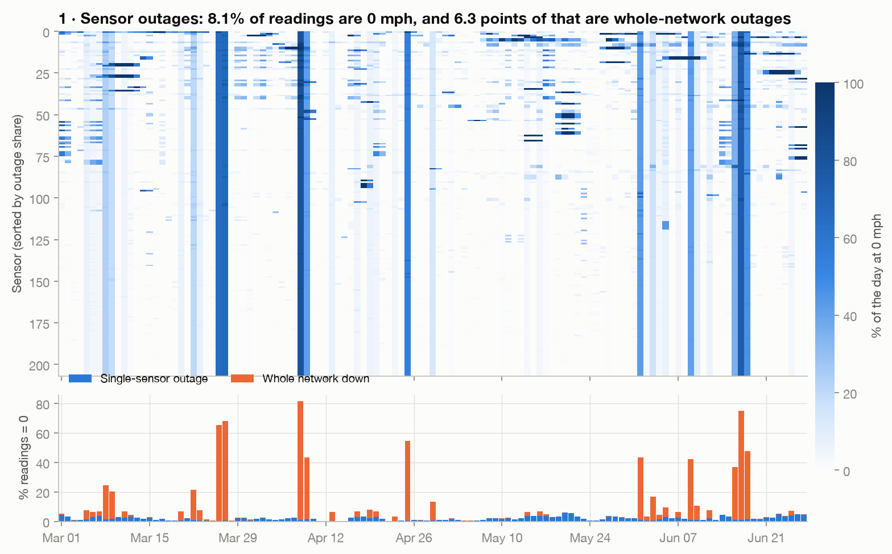
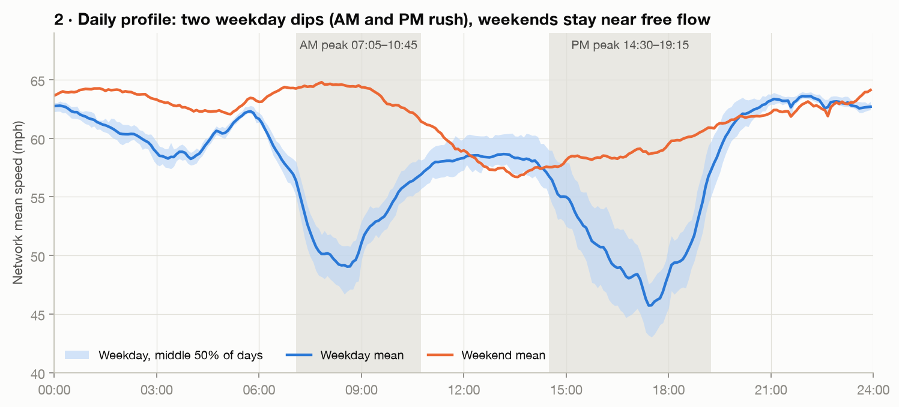
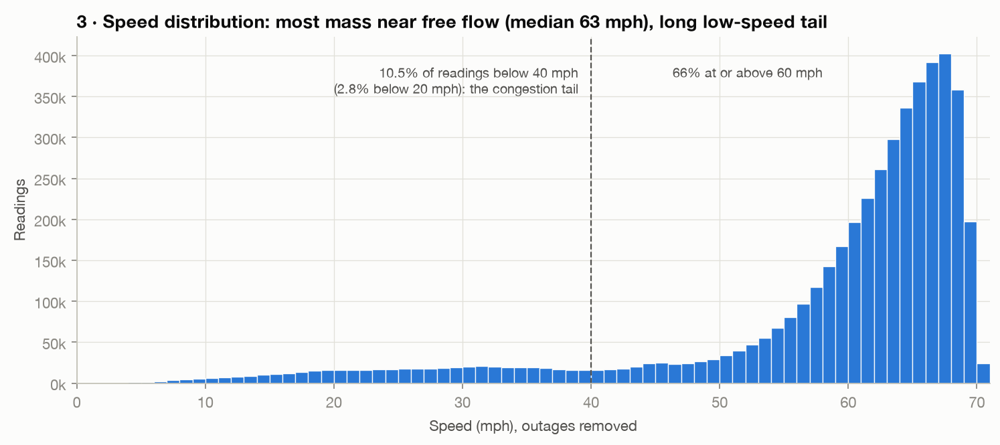
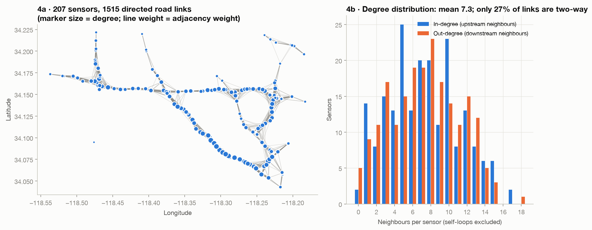
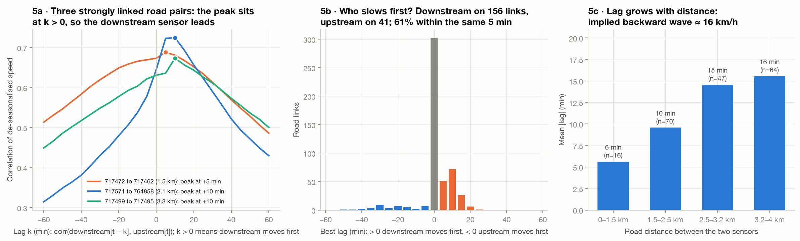

# Phase 1 report: METR-LA data and exploratory analysis

**Status:** ✅ complete · **Notebook:** [`notebooks/01_eda.ipynb`](../../notebooks/01_eda.ipynb) · **Numbers:** [`results/phase1_findings.json`](../../results/phase1_findings.json) · **Code:** `src/data/load.py`, `src/analysis/eda.py`, `src/viz/eda_plots.py` · **Tests:** `tests/test_data.py` (9 passing)

Re-run everything with `make eda`.

## Checklist (from the playbook)
- [x] Data downloaded (`metr-la.h5` from the DCRNN README's Drive link; graph files from the repo)
- [x] Column order verified against the graph (enforced in `load_all()` and in tests)
- [x] Five EDA figures saved to `reports/figures/` (+ a worked example and an interactive map)
- [x] Findings written: missing %, peak windows, typical propagation lag

## The data

| | |
|---|---|
| Speed matrix | 34,272 timestamps × 207 sensors (mph), 5-min clock with **no gaps** |
| Period | 2012-03-01 00:00 → 2012-06-27 23:55 (119 days, 17 of each weekday) |
| Train period used for EDA | first 70% → ends 2012-05-23 07:05 |
| Graph | 207×207 directed Gaussian-kernel adjacency, 1,515 off-diagonal links, self-loops = 1 |

**Loader note.** `metr-la.h5` was written by pandas 0.15 under Python 2; pandas 3 fails on its byte-string metadata. `load_speed()` falls back to reading the HDF5 "fixed" layout with `h5py`.

**Discipline.** Anything that could influence modelling (profiles, peaks, lags) was computed on the **train period only**. Missingness covers the full period, because it is a data-quality check.

---

## 1 · Missingness

- **8.11%** of readings are 0 mph (= sensor down).
- **6.27 points** of that are **whole-network outages**: 2,148 timestamps where all 207 sensors read 0 at once. The longest lasts 31.8 h. These are logging/system failures, not traffic.
- Only **1.84 points** are single-sensor outages. The worst sensor (718076) is down 20.1% of the time; only one sensor exceeds 20%.

**Implication (Phase 2):** treat 0 as missing everywhere; add a mask input channel; use masked loss and metrics; drop training windows whose targets are almost entirely masked.

## 2 · Daily profile

- Weekday **AM dip 07:05–10:45** (low point 49.0 mph) and a deeper, longer **PM dip 14:30–19:15** (45.7 mph). Free flow ≈ 63 mph.
- Weekends never fall below 56.7 mph.
- Windows are detected from the data (weekday mean < 90% of free flow for > 30 min). The brief's fixed definition (AM 07:00–09:59, PM 16:00–19:59) sits inside them, so Phase 6 can use it as stated.

**Implication:** time-of-day *and* weekday/weekend features are essential; peak results must be reported separately.

## 3 · Speed distribution

Median 63 mph; **66%** of readings ≥ 60 mph; **10.5%** < 40 mph; 2.8% < 20 mph.

**Implication:** average MAE is dominated by easy free-flow periods. A model can look good on average and still miss every jam. Phase 6 breaks results down by peak, and Phase 4 by congestion onset.

## 4 · The sensor graph

Interactive version: `reports/figures/fig04_sensor_graph_map.html` (open in a browser; hover shows sensor IDs and degrees).

- Mean degree 7.3 (in = out on average), max 17–18.
- **Only 27% of links are two-way.** Direction carries information.
- 1 isolated sensor (no neighbour within the kernel threshold); 2 weakly connected components.

**Implication:** keep the adjacency directed (Phase 2); test directed vs undirected (Phase 5).

## 5 · Spatial propagation (the figure that motivates the project)

**Method.** Each sensor's (weekday/weekend × 5-min slot) mean was subtracted, leaving day-specific disturbances. Raw speeds share the daily rhythm, so they correlate at every lag and would be useless here. For each directed link *upstream → downstream*, cross-correlation was computed at lags −60…+60 min. Links with peak correlation < 0.3 are "weak" and excluded from the lag statistics.

| Result | Value |
|---|---|
| Links in the fixed graph | 1,515 |
| **Weak links** (peak corr < 0.3) | **62.2%** |
| Strong links with a clear peak | 499 |
| …co-moving within the same 5-min step | 60.5% |
| …**downstream sensor moves first** | **156** |
| …upstream sensor moves first | 41 |
| Median lag (lagged links) | 10 min |
| Lag vs distance | 6 min (< 1.5 km) → 10 → 15 → 16 min (3.2–4 km) |
| Implied backward wave speed | **≈ 16 km/h** |

**Reading it.**
1. **Congestion travels through the graph, mostly backwards.** A jam forms at a bottleneck and the queue grows upstream, so the downstream sensor sees it first. 16 km/h is the textbook speed of a traffic shockwave, which is a strong sanity check that the graph direction and the masking are right.
2. **Worked example (fig 5d), Wed 2 May 2012:** both sensors flow at ~68 mph. At 06:40 downstream sensor 717462 crashes; sensor 717472, 1.5 km upstream, is still at 66 mph. It crashes to 17 mph at 06:50. A per-sensor model for 717472 cannot see this coming; a graph model watching 717462 can.
3. **Correction to the playbook.** The playbook's example has the upstream sensor slowing first. On this data that is the minority case (41 vs 156). Either way the predictive information sits at a *neighbour*, which is the gap the project closes.

---

## What changes in later phases because of Phase 1

| Finding | Action | Phase |
|---|---|---|
| 6.3 pts of zeros are whole-network outages | Mask; mask channel; drop all-masked training windows | 2 |
| Reference DCRNN pipeline: window split + scaler with zeros | Two protocols: `dcrnn` (comparability) and `strict` (purge gap, NaN-aware scaler) | 2 |
| Brief's peak definition sits inside the observed dips | Use it as written in Phase 6 | 6 |
| Downstream-first propagation is 4× more common | "XGB + neighbours" with upstream / downstream / both variants | 4 |
| Same | STGAT gets reverse edges + direction edge feature (GAT otherwise only hears upstream) | 5 |
| 62% of fixed links are weak | Prefer attention over fixed-weight GCN; learned adjacency as Phase 9 ablation | 5, 9 |
| Lag ≈ 10–16 min | Expect the GNN gain to appear from ~15 min horizons onwards | 6 |
| Backward wave ≈ 16 km/h | Time-space diagram should show stripes with that slope | 7 |
| Daily profile shape | Use it as the demand curve for the SUMO simulation | 8 |

## Limitations to state in the final report
- METR-LA is **speed only**; flow and occupancy come in Phase 9 via PeMS.
- 2012 data from one city's freeways; no signalised intersections (that is why Phase 8 is a synthetic simulation).
- Cross-correlation shows lead–lag association, not causation. The worked example is an illustration chosen by a rule (`eda.pick_example`), and the evidence is the all-link statistics.
