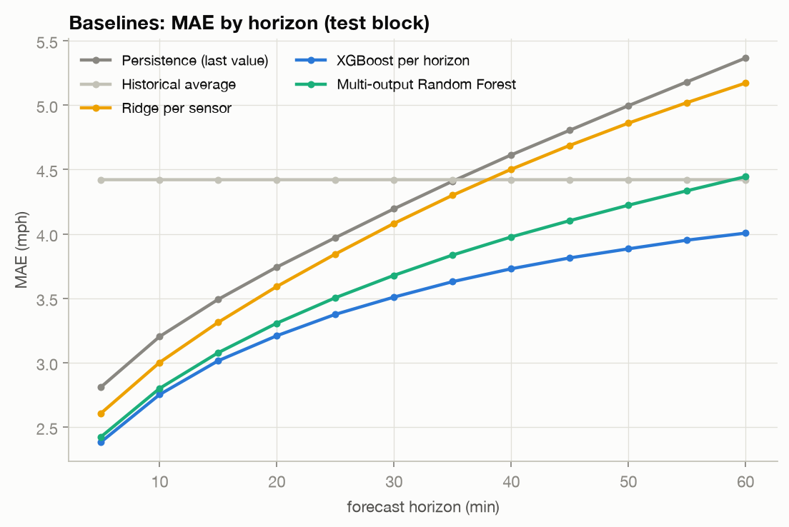
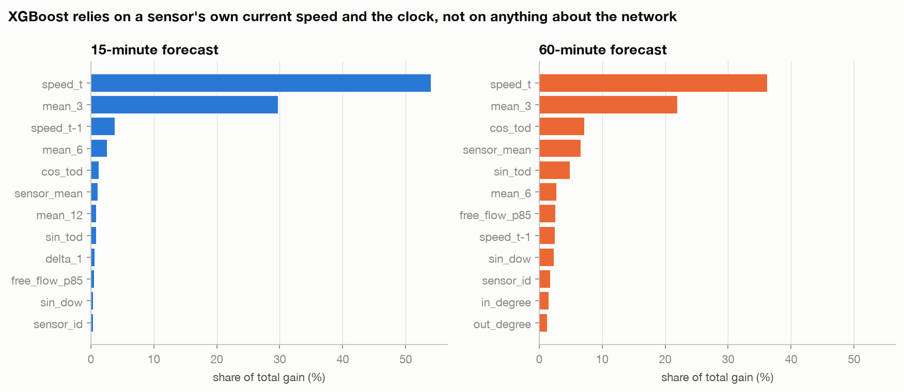

# Phase 3 report: ML baselines (strong, honest, per-segment)

**Status:** Complete · **Table:** [`results/baselines.csv`](../../results/baselines.csv) · **Per-horizon results:** `results/baselines/<model>.csv` · **Code:** `src/features/build.py`, `src/models/{simple,trees,lstm}.py`, `src/train/baselines.py`, `src/eval/evaluate.py` · **Tests:** `tests/test_baselines.py`

Re-run with `make features baselines`.

## Checklist (from the playbook)
- [x] Feature table: lags, rolling stats, changes, missing flags, time, segment (46 columns)
- [x] Rung 0 persistence · rung 1 historical average · rung 2 Ridge per sensor
- [x] Rung 3 **XGBoost per segment** (brief) · rung 4 **multi-output Random Forest** (brief)
- [x] Rung 5 LSTM with no graph, weights shared across sensors
- [x] `results/baselines.csv`: MAE / RMSE / MAPE at 15 / 30 / 60 min
- [x] XGBoost feature-importance plot
- [x] Paragraph: strongest baseline and where it degrades
- [x] Peak vs off-peak breakdown (brief: fair comparison)

## Protocol (same for every rung)
- Phase 2 strict split: train / val / test by time with a purge gap. **Hyper-parameters are chosen on val only**; test is reported, never used to choose.
- **Equal history:** every model sees exactly the last 12 steps (60 min). The tree-model lags are the same 12 steps the GNN will get.
- **Masks:** outage targets never count in a loss or a metric (XGBoost weight 0, RF drops those training rows, LSTM masked loss). All errors in mph.

## Feature table (one row = one sensor at one forecast origin)
| Group | Columns |
|---|---|
| Lagged speed | `speed_t … speed_t-11` (12) |
| Rolling | mean / std / min over 3, 6, 12 steps (9) |
| Change | `speed_t − speed_t-1`, `speed_t − speed_t-3` |
| Missing | real-reading flag per lag (12) + number of imputed lags |
| Time | sin/cos time-of-day, sin/cos day-of-week, weekend |
| Segment | sensor id, train mean speed, free-flow (85th pct), in/out degree (all from **train** only) |
| Flow, occupancy | **not in METR-LA** (speed only) → PeMS in Phase 9; stated as a limitation |

4.75 M train rows, 0.71 M val, 1.42 M test, stored as memory-mapped `.npy` (fits an 8 GB laptop).

## Results (test block, mph)

| Rung | Model | MAE 15 | MAE 30 | MAE 60 | RMSE 60 | MAPE 60 |
|---|---|---|---|---|---|---|
| 0 | Persistence | 3.49 | 4.20 | 5.37 | 10.29 | 14.5% |
| 1 | Historical average | 4.42 | 4.42 | 4.42 | 8.08 | 13.9% |
| 2 | Ridge per sensor | 3.31 | 4.08 | 5.17 | 8.67 | 15.5% |
| 3 | **XGBoost per horizon** | **3.02** | **3.51** | **4.01** | **7.28** | **12.0%** |
| 4 | Multi-output Random Forest | 3.08 | 3.68 | 4.45 | 7.85 | 13.5% |
| 5 | LSTM (no graph) | **2.97** | 3.55 | 4.35 | 8.84 | 13.5% |

**Strongest baseline: XGBoost.** It beats persistence by 14% at 15 min and 25% at 60 min, has the lowest average MAE (3.44), the lowest RMSE at every horizon and the lowest MAPE at 30 and 60 min; only the LSTM edges it at 15 min (MAE 2.97 vs 3.02, MAPE 8.0% vs 8.2%). Its error still grows steadily with horizon (3.02 → 4.01 mph MAE, 5.47 → 7.28 RMSE): beyond ~15 min the information it needs is no longer in the sensor's own history. That is the gap Phase 4 measures. Historical average is flat (it ignores the present); at 60 min it beats persistence and Ridge but not the tree models.

## Peak vs off-peak (test block, MAE in mph)
Peak = weekday 07:00–09:59 and 16:00–19:59 (the brief's definition), judged on the timestamp being predicted. Full table with RMSE / MAPE and counts: [`results/baselines_peak.csv`](../../results/baselines_peak.csv).

| Model | Peak 15 / 30 / 60 | Off-peak 15 / 30 / 60 | Weekend 15 / 30 / 60 |
|---|---|---|---|
| Persistence | 4.61 / 6.05 / 8.32 | 3.25 / 3.74 / 4.62 | 2.86 / 3.31 / 3.98 |
| Historical average | 6.82 / 6.82 / 6.82 | 3.58 / 3.58 / 3.58 | 3.94 / 3.94 / 3.94 |
| Ridge per sensor | 4.58 / 6.02 / 7.93 | 3.00 / 3.56 / 4.40 | 2.71 / 3.27 / 4.10 |
| Random Forest | 4.31 / 5.51 / 7.08 | 2.75 / 3.15 / 3.63 | 2.56 / 3.02 / 3.65 |
| LSTM (no graph) | **4.16** / 5.34 / 6.96 | **2.69** / 3.09 / 3.66 | **2.39** / **2.75** / **3.23** |
| **XGBoost** | 4.22 / **5.22** / **6.23** | **2.69** / **3.01** / **3.32** | 2.50 / 2.89 / 3.33 |

Peak-hour error is 1.4–1.9× the off-peak error for every model, and the peak penalty grows with horizon (XGBoost: 4.22 → 6.23 at peak vs 2.69 → 3.32 off-peak). Rush hours are exactly when congestion forms and travels, so this is where a network-aware model has the most to gain.

## XGBoost: design and tuning
- One model per horizon (12), all 207 sensors stacked, sensor id as a feature. Still **independent**: a row never contains a neighbour's speed.
- Every 2nd window used for training (windows are 5 min apart, so neighbours are near-duplicates; this halves memory).
- Depth searched on the 30-min horizon, scored on val: depth 6 → 3.413, 8 → 3.342, **10 → 3.291** (picked). η = 0.05, subsample / colsample 0.8, early stopping (50) on val, up to 600 trees. Most horizons used all 600 trees, so a larger budget could gain a little more; the same budget will be given to the GNN.

Share of total gain: `speed_t` 54% and `mean_3` 30% at 15 min; at 60 min `speed_t` falls to 36% and time-of-day + sensor descriptors rise (cos/sin tod 12%, sensor mean 7%). The model leans on "now" and "what time is it"; it has nothing that tells it a jam is coming from elsewhere.

## Random Forest
100 trees, depth 20, min leaf 10, 30% bootstrap, 50% features per split, trained on every 6th window with fully observed targets (742,613 rows). One forest predicts all 12 horizons. Close to XGBoost at 15 min, clearly worse at 60 min.

## Ridge per sensor
207 × 12 linear models on each sensor's own time-varying features; α picked on val (1,000; differences across α were < 0.01 mph). Good at 15 min, worst MAPE at 60 min: a linear model extrapolates the recent trend too far.

## LSTM (no graph)
Two LSTM layers (64 units), one set of weights shared by all 207 sensors; each sensor's own 12 × 7 input window in (speed, mask, time features), 12 horizons out. Masked MAE in mph, Adam (lr 2e-3, halved on plateau), gradient clipping 5, early stopping on val (patience 3, max 12 epochs). Best val MAE 3.208 (pooled over 12 horizons) after 12 epochs, on Apple MPS.

It is the best model at 15 min (2.97 vs XGBoost 3.02) but falls behind XGBoost at 30 and 60 min (3.55 / 4.35 vs 3.51 / 4.01), and its RMSE is higher at every horizon. Deep learning alone does not fix long-horizon error: the LSTM has the same information problem as XGBoost (one sensor's own history). This is the reference the Phase 5 GNN must beat; if it does, the gain comes from the graph.

## Engineering note
XGBoost (Homebrew `libomp`) and PyTorch (bundled `libomp`) crash when loaded in one process on macOS. The runner imports XGBoost only inside the tree-model steps, so the LSTM never loads it.
