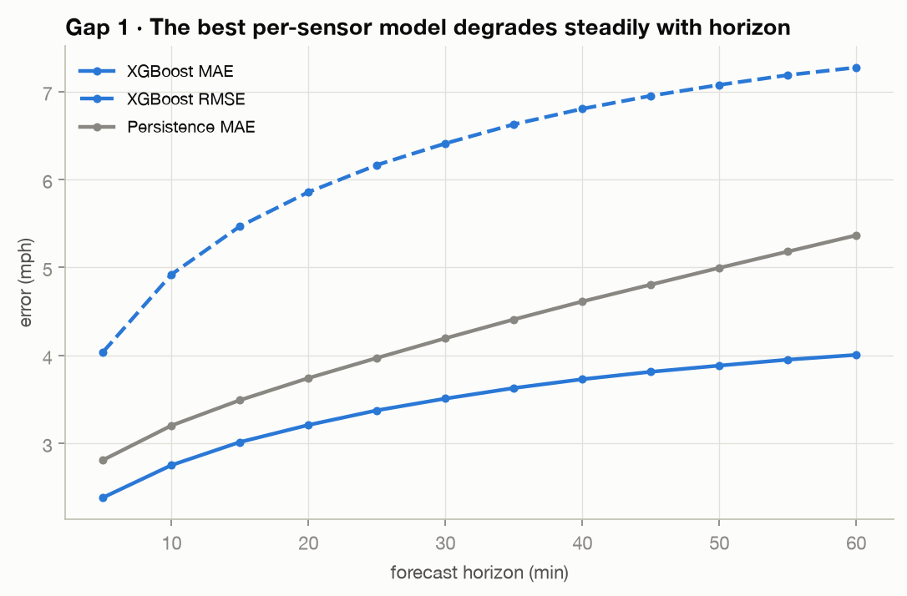
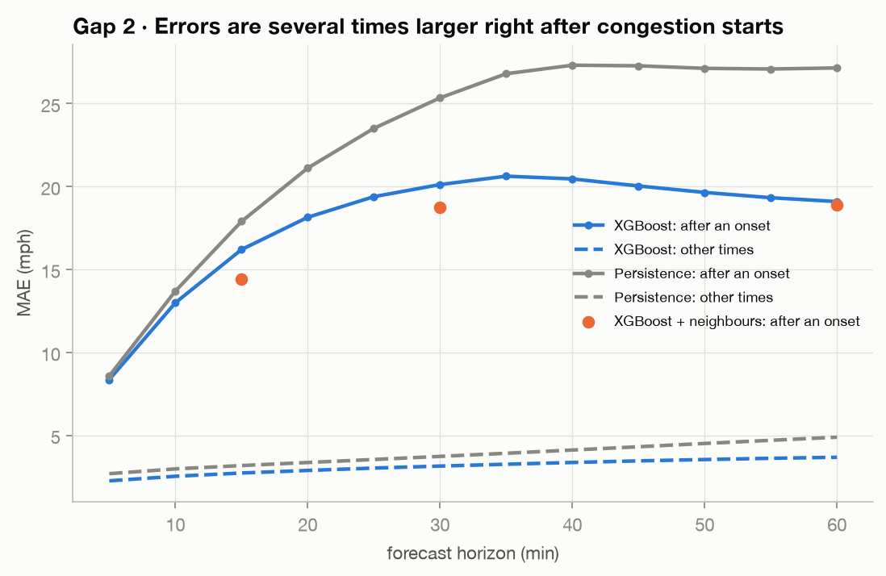
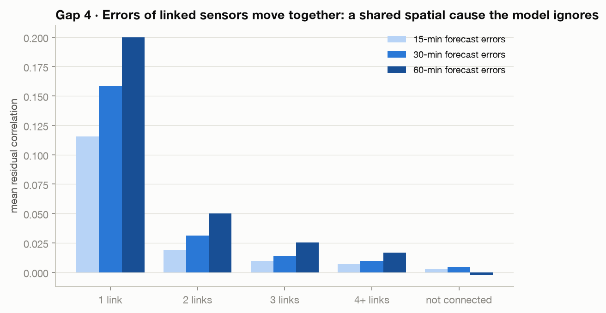
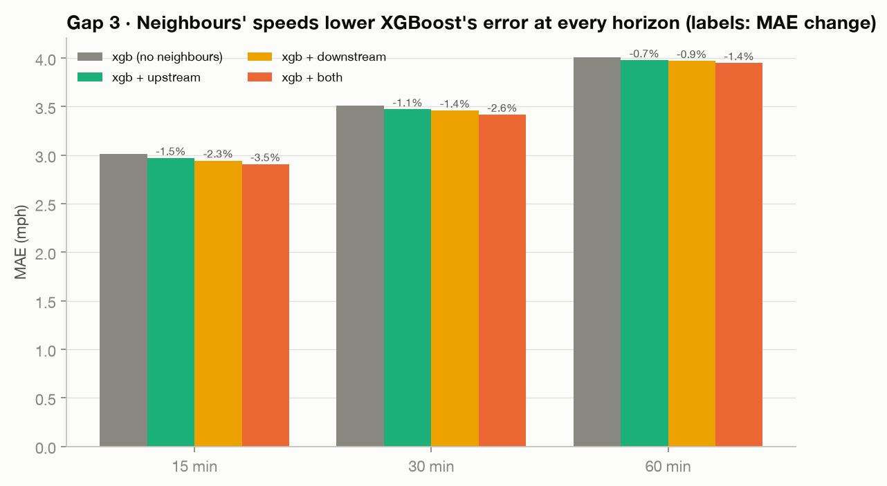

# Phase 4 report: identify the gap with evidence

**Status:** Complete · **Numbers:** `results/gap/`, [`results/phase4_findings.json`](../../results/phase4_findings.json) · **Code:** `src/analysis/gap.py`, `src/train/phase4.py`, `src/viz/gap_plots.py` · **Tests:** `tests/test_gap.py`

Re-run with `make gap`.

The question: an independent per-sensor model (Phase 3's best, XGBoost) only sees its own sensor's history. Does it fail **exactly where congestion propagates between sensors**? Everything below uses the **test** block and the XGBoost predictions saved in Phase 3.

## Checklist (from the playbook)
- [x] 1 · Error vs horizon
- [x] 2 · Error at congestion onset vs normal periods
- [x] 3 · Neighbour-information test: XGB + upstream / downstream / both
- [x] 4 · Residual correlation along road links
- [x] "XGB + neighbours" rows in [`results/gap_results.csv`](../../results/gap_results.csv)

## 1 · Error grows steadily with horizon

XGBoost MAE 3.02 → 3.51 → 4.01 mph and RMSE 5.47 → 6.41 → 7.28 at 15 / 30 / 60 min. Beyond ~15 min the jam that will arrive is not yet visible in the sensor's own history; it is sitting at a neighbour.

## 2 · Errors explode right after congestion starts

Onset = the Phase 1 definition (speed drops > 20 mph within 15 min from ≥ 50 mph; 3-step rolling median). A target counts as "after an onset" if it lies within 30 min after one at that sensor. The test block holds **3,911 onsets**; these targets are 2.2% of all real targets.

| Horizon | XGB MAE after onset | XGB MAE other times | Ratio |
|---|---|---|---|
| 15 min | 16.20 | 2.72 | 5.9× |
| 30 min | 20.12 | 3.14 | 6.4× |
| 60 min | 19.09 | 3.67 | 5.2× |

The model reacts late: it keeps forecasting free flow until the slowdown shows up in its own lags. Persistence fails the same way (and worse), so the issue is the information available, not the learner.

## 4 · Errors of linked sensors move together

For each pair of sensors, the correlation of their XGBoost residual series (only timestamps where both are real), grouped by road-graph distance:

| Pair distance | 15 min | 30 min | 60 min |
|---|---|---|---|
| 1 link | **0.115** | **0.158** | **0.200** |
| 2 links | 0.019 | 0.031 | 0.050 |
| 3 links | 0.010 | 0.014 | 0.025 |
| 4+ links | 0.007 | 0.010 | 0.017 |
| not connected | 0.003 | 0.005 | −0.002 |

Errors are correlated **only along the road graph** and the effect decays with every hop. A network-wide cause (e.g. time of day) would correlate unconnected pairs too; it does not. The correlation also grows with horizon, as expected if the missing information is congestion travelling between sensors.

## 3 · Neighbour-information test: the key experiment

XGBoost is given hand-made features of each sensor's road neighbours (weighted mean speed now and 5 / 15 / 30 min ago, slowest neighbour now, largest 15-min drop among neighbours), for upstream only, downstream only, and both directions. Same depth (10), same row thinning, same early stopping, **no extra tuning**; one model each for 15 / 30 / 60 min.

| Test MAE (mph) | 15 min | 30 min | 60 min |
|---|---|---|---|
| XGBoost, own history only | 3.015 | 3.510 | 4.006 |
| + upstream neighbours | 2.971 (−1.5%) | 3.472 (−1.1%) | 3.978 (−0.7%) |
| + downstream neighbours | 2.945 (−2.3%) | 3.461 (−1.4%) | 3.971 (−0.9%) |
| **+ both directions** | **2.908 (−3.5%)** | **3.418 (−2.6%)** | **3.949 (−1.4%)** |

Validation shows the same ordering (both: −4.2 / −3.8 / −2.5%). RMSE and MAPE drop too (both directions, 15 min: RMSE 5.47 → 5.17, MAPE 8.2% → 7.7%).

- **Spatial information matters.** Every variant beats the independent model at every horizon, with nothing else changed.
- **Downstream > upstream**, as Phase 1 predicts: congestion propagates backwards, so the jam that is coming is first visible downstream (downstream-first was 4× more common). Both directions together are best.
- **It helps most where the gap is.** In the 30 min after a congestion onset, MAE falls from 16.20 → 14.42 mph at 15 min (−11%) and 20.12 → 18.77 at 30 min (−7%), far more than the 2–3% average gain.
- **But hand-made, one-hop features only scratch the surface.** Residual correlation between linked sensors barely moves (0.115 → 0.107 at 15 min, 0.200 → 0.197 at 60 min), the gain shrinks at 60 min (when the relevant jam is several links away), and onset errors are still 5–6× normal. The 12 neighbour features together get only 4.5 / 6.3 / 7.8% of XGBoost's total gain at 15 / 30 / 60 min: a tree model cannot learn *which* neighbour matters *when*, nor look several hops out. That is what attention over the road graph (GAT) and multi-hop diffusion (DCRNN) are designed to learn.

## Gap statement
> Independent segment models forecast each sensor from its own history. Congestion forms at bottlenecks and travels backwards along road links at ~16 km/h (Phase 1), so at longer horizons the most predictive information sits at neighbouring sensors. We observe this as error rising steadily with horizon (3.02 → 4.01 mph MAE), errors 5–6× larger in the 30 minutes after a congestion onset, and residuals correlated only between road-linked sensors (0.12–0.20 on one link, ≈ 0 when unconnected). Handing XGBoost one-hop neighbour summaries lowers error at every horizon (up to −3.5%, −11% after onsets), showing the missing information is spatial, yet leaves linked residuals correlated and onset errors 5–6× normal. A graph model that learns which neighbours matter, over several hops, should close this gap; Phase 5 tests that against the same splits, windows, masks and metrics.
